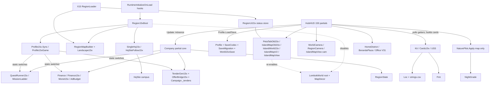

# ARCHITECTURE_DISCOVERY — Renewable Manager U37H (Batch 0, read-only)

Directive: `docs/remediation/MASTER_ENGINEERING_DIRECTIVE_U37H.md` §6 + §21. Date 18 Nov 2026. Static source inspection only: no code changed, Unity not run.
Paths are relative to `/srv/rm/RenewableCEO/Assets/Scripts/` unless stated otherwise. **UNVERIFIED** = inferred from the code and not confirmed at runtime.

## 0. Access and build identity
| Item | Value |
|---|---|
| Unity project | `/srv/rm/RenewableCEO` (repo `/srv/rm`, branch `master`, HEAD `dda07ec patch vis15x_r37h4` = build U37H) |
| Work repo | `/srv/rm/work` (branch `work/2026-11-03`, HEAD `9529e1df`) |
| Last patches on HEAD | `dda07ec vis15x_r37h4` ← `d35f4a6 vis15x_r37k3` ← `dd45926 rollback vis15x_r37k2` ← `0f0e333 re-apply vis15x_r37h3` ← `1481a05 rollback r37h3` ← `8bfe424 uipolish15x_r37z` |
| Audit | `docs/qa/AUDIT_UI_FULL_18NOV_part1/2.json` (fields id/screen/profile/area/severity/finding/where/rule/suggest), PDF `docs/qa/pdf/AUDIT_TAMPILAN_18NOV.pdf` (not read in this batch) |
| Missing access | No device and no Android build (APK only when the user asks). Runtime behaviour not observed in this batch. |

## 1. Engine, platforms, structure, boot
- **Engine**: Unity `6000.6.7f1` (`ProjectSettings/ProjectVersion.txt`). **Render pipeline**: built-in (`GraphicsSettings.asset:50 m_CustomRenderPipeline: {fileID: 0}`). Custom toon/HC shaders live in `Assets/Shaders`.
- **Targets**: Android (`Editor/Build/AndroidBuild.cs:31,85`, `AndroidBuild.Aab.cs:135`), WebGL (`Editor/Build/WebBuild.cs:71,158`), Linux/Windows standalone for QA (`/srv/rm/work/tools/unity/audit_runner.sh:15` runs `WorldSlice.exe`).
- **Assemblies** (asmdef):

| Assembly | Files / lines | References |
|---|---|---|
| `RenewableCEO.Core` (`Scripts/Core`) | 292 / 52,369 | none (pure C#, no Unity scene dependency) |
| `RenewableCEO.Game` (`Scripts/Game`) | 413 / 96,593 | Core, Unity.2D.Animation, Unity.Purchasing |
| `RenewableCEO.Editor` (`Assets/Editor`) | 60 / 19,521 | Core, Game; Editor only |
| `RenewableCEO.Editor.Automation` | 2 / 516 (`JobRunner.cs`, `SdkSetup.cs`) | – |
| Tests `RenewableCEO.Core.Tests` + `Game.Tests` (EditMode) | 373 / 55,931; 2,277 `[Test]/[TestCase]/[UnityTest]` attributes (audit: 2,202 passed) | – |

  Core folders: Simulation (partial `Company.*`, ~90 parts), Economy, Progress (quests/tiers), Tenders, Projects, People, Wellness, Contractors, Cosmetics, World (+ `World/X15` for 15× data, `World/Map` for the geometry model L1).
  Game folders: UI (`Screens` = **159 `HubHUD.*` partials**, `Common` = Kit/Loc/Fmt, `X15` = 15× cards), World (+`World/X15`), Characters (+Motion, A2), Audio, Diagnostics (monetization, telemetry, perf), Save, Legacy.
- **Scenes**: the **real game scene is `Assets/Scenes/WorldSlice.unity` (32.9 MB)**. It is **not** in `EditorBuildSettings` (which lists `Beta.unity` = `GameUI`+`AutoShot`, and `Prototype.unity` = `PrototypeGame`, both legacy); the build scripts pass the scene explicitly (`AndroidBuild.cs:31`, `WorldSliceBuilder.ScenePath`). Prototype scenes: `Scenes/Proto/Village15x.unity`, `RegionAssets165.unity`; `CharacterPreview.unity`.
  WorldSlice root objects: `Sun, Home Plaza, Plant Showcase Anime, Office, HQ Site, Map Templates, World Camera, Office V31, Hub HUD, Office Crew, Plant Showcase, LombokWorld`. Main components include `HubHUD`×1, `MapDecor`×1, `HqSite`×1, `BerandaPlaza`×1, `HomeDistrict`×1, `WorldCamera`×1, `WorldChunkLod`×1, `MapVillageClient`×105, `FbxUserProps`×3,512.
- **Boot**: `[RuntimeInitializeOnLoadMethod]` hooks (BeforeSceneLoad: `GameAudio.cs:25`, `WorldTone.cs:18`, `HydroRiversBoot.cs:12`, `HubHUD.Islands.cs:31`; AfterSceneLoad: `HubHUD.WorkHours.cs:559`, `HubHUD.Soak.cs:31`, `HubHUD.OutingTrip.cs:974`, `HubHUD.WellnessWorld.cs:445`, `HubHUD.SoftLaunchAudio.cs:334`, `HubHUD.AuditSl.cs:364`, `FleetView.cs:51`, plus `Region15xBoot` → `Profile15xGame` → `Profile15x.Sync()`) → `HubHUD.Start()` (`Game/UI/Screens/HubHUD.cs:66`): `Profile.Load()` (:141), `new Company(...)` (:159) or `LoadCompanySafe()` (:264) → `HubHUD.Update()` (:391) calls `_company.Advance(Time.deltaTime * Speeds[_speed])` (:397).
  `Region15xBoot` (`Game/World/X15/Region15xBoot.cs:48-49`) disables the root `LombokWorld` (old island) and builds the HQ region from `Resources/World15x/region_hq_v5.json` through `RegionMapBuilder`, then `HqSiteFollow15x.Attach` (:52) and `SingleHq15x.RelocateCampus` (:53).

## 2. Main systems
### 2.1 Company and the simulation core
- `Core/Simulation/Company.cs` (994 lines) plus ~90 partials. It is one god-object holding all gameplay state: `Cash` (:27), `GameHours` (:29), `Tier` (:60), events `StageChanged/IncidentHappened/EventRaised/EmployeeLeft` (:68-71), and 64 `event` declarations across Simulation.
- Tick: `Company.Advance(realSeconds)` (`Company.cs:697-741`) runs an event-stepped loop (next month, next stage, small project, outing, work-hours boundary), then the per-frame subsystem ticks: `TickCampaign, TickSafetyNet, TickIslands, TickQuestClock, TickWorldAlive, TickTierRewards, TickX15Daily, X15ConnectorJobsTick, TickX15Tenders, TickX15Factories, TickX15OfferBridge`.
- There is no global event bus. `Core/Events/GameEvents.cs` only holds DTOs (Incident, EventKind, PendingEvent). Communication = C# events on `Company` + **UI polling** (HubHUD rebuilds cards from `Company` getters) + static `Func<>` injection hooks (e.g. `QuestRunner15x.KoinK` set at `Company.QuestRunner15x.cs:52`, `RegionLoader.Tier`).

### 2.2 Time and clock
- `Core/Simulation/GameTime.cs:6-24`: 1 game year = 30 real days; `ClockStartHour = 8`; `HourOfDay(gameHours)`. The game clock lives on `Company.GameHours` and is persisted (`Company.Save.cs:23,304,413` `gameHours,nextMonthHour`).
- `TrustedClock`/`Game/Save/TrustedTime.cs` (anti-cheat real time); offline progress through `Pacing15x`/`Monet15x` (8/12 h cap).
- `Company.WorkHours.cs:85` `HourNow` has a QA override `QaHourOverride` (captures force the hour).

### 2.3 Economy
- `Core/Economy/Finance.cs`, `FinanceConfig`, `Finance15x.cs:21` (static, `Enabled=false` at :23 and turned on by `Profile15x`; `Active => Enabled && World15x.Enabled`; equity shares, insurance, starter loan as public static fields :26-79), `EconomyLadder`, `Loan`, `SafetyNet`, `SavingsBox`, `StorePricing`, `Tuning` (`Core/Simulation/Tuning.cs:12`), `ContentCatalog` (`Core/World/X15/ContentCatalog.cs` tier rows incl. `KoinK`, `SmallKoinK` :32,437-439).
- Koin K multipliers: `QuestRunner15x.KoinK` (`Core/Progress/QuestRunner15x.cs:152`, defaults to 1 and is wired by Company), `SmallProjects.LevelMult` (`Core/Progress/SmallProjects.cs:349`), `Company.SmallKoinK15x`.
- Formatting: `Game/UI/Common/Fmt.cs` `Coins()` (:54), `CoinLabel()` (:48) falls back to `"$"+amount` when `CoinWords` is false, culture = `Loc.Culture` (:14). There are **42 call sites** with raw `Coins(`/`"$"+`/`ToString("N0")` in Game/UI; e.g. `HubHUD.Monet15x.cs:97,107`, `HubHUD.MonetFill15x.cs:57` build `"Rp"+x.ToString("N0")` **without culture** (thread culture), and `HubHUD.Shop.cs:41` uses a `"$"` fallback. A private `Money()` helper exists in `HubHUD.Team.cs:353`.

### 2.4 Quests
- `Core/Progress/QuestRunner15x.cs:110` (15× runner; save DTO :20; switches `Enabled, MixEnabled, MixRotation…` :112-145, `On => Enabled && World15x.Enabled`), `QuestSteps15x.cs:18` (step kinds → `QuestEngine.EventSteps`, e.g. `tutorial_tender → win_tender` :62), legacy `Quests.cs`, `MissionLadder*`, `Company.Quests/QuestMechanics/QuestRunner15x`, MX board `Core/World/X15/SmallBoard15x.cs` + `Game/World/X15/SmallBoard15xUi.cs`, dialogue `QuestDialogue15x`/`QuestOffer15x` (UI). UI: `HubHUD.Quests.cs`, `HubHUD.Missions.cs`, `HubHUD.QuestMech.cs`, `HubHUD.QuestTarget.cs`.
- There are **two quest ladders**: the tutorial `MissionLadder` (profile `mission` index, `HubHUD.Missions.cs:266-276`) and `QuestRunner15x`.

### 2.5 Tenders
- `Core/Tenders/TenderGen15x.cs:44` (15× offer generator; milestone/tutorial tenders), `Company.Tenders15x.cs:20-36` (attach), `Company.OfferBridge15x.cs:12-33` (TenderGen15x offers → catalog `RegionTender` cards, close/finish back to the generator), legacy `Company.Campaign.cs:65` `IReadOnlyList<RegionTender> Tenders` (`_tenders.Add` :290), `Company.Tutorial15x.cs:39-58` (`X15TutorialTender`, `CreateTutorialTender`), `InfraTender`, `RegionTender`, `Customers`. UI: the tender tab is drawn in `HubHUD.Projects.cs`/`HubHUD.TenderChoices.cs` (polls `_company.Tenders`; ~35 UI files read `.Tenders`).
- **U1-002 lead (UNVERIFIED)**: `HubHUD.Missions.cs:271-275`: the mail "tutorial_tender" is posted when `CreateTutorialTender(_profile.hq)` returns non-null, where `_profile.hq` is an **H3 hex index** (`Game/Save/Profile.cs:74`). The board reads `Company.Tenders`, but the 15× path has its own `X15TutorialTender`/`TenderGen15x` offers, and visibility filters on the board may differ. The notification and the board therefore read different sources/filters. Needs a runtime trace.

### 2.6 Projects / survey / feasibility / construction / operation
- `Core/Projects/Project.cs`, `StageConfig`, `SolarProject`, `PlantKinds`, `HydroRivers`, `SubseaChain`, `StorageArbitrage`, `BatteryAging`; stage timing in `Company.Advance` (`WhTickStage`, `CompleteStage` :743 → `BeginCommissioning`); survey/screening `Company.Screening`, `Company.Exploration`, `Company.Land/GridLand/Slots` (hex `SiteCell`), 15× slots `Company.SiteTargets15x`, `ConnectorSlots15x`, `Region15xGrid` (rect → `RegionTile`/`BuildSlot` with a `HexId` compatibility field, `Core/World/X15/Region15xGrid.cs:10,76,159`); operation `AccrueOperations`, `AccruePpa`, `Company.Maintenance/Overhaul/MaintContract`; contractors `Core/Contractors/*` (`FleetSim`, `OwfFleet15x`, `SubseaWire15x`).

### 2.7 Employees / hiring / skills
- `Core/People/Employee.cs`, `Recruitment`, `TeamEffects`, `Affinity`, `NamedNpcs`; `Company.Hiring/Skills/SmallCrews/WorkHours`; `Core/Progress/HiringLadder`, `SkillTree`; wellness `Core/Wellness/*`. UI: `HubHUD.Team/TeamHub/Recruit/Crew/Skills/InterviewScene`.

### 2.8 HQ and office interior
- `Game/World/HqSite.cs:46` (MonoBehaviour on scene root `HQ Site`; per-hex zone data from `Resources/World/hq_zones.json`; r37h4 landmark fit :52,114-150), `HqBuildView.cs:27` (HQ construction stages, driven by Core `HqBuildProgress`), `HqcBuildScene.cs`, `Game/World/X15/SingleHq15x.cs:12` (reconciles the campus with the baked plan HQ; `RelocateCampus`, `LandmarkOn=true` :67), `HqStageView15x.cs` (HQ_T<n> by tier; placeholder boxes when the FBX is missing), `HqSiteFollow15x.cs` (campus follows the HQ region root), Core `Company.Hq/HqCompound*`, `Core/World/HqCompound`, `HqZones`, `HqPlazaDecor15x`. UI: `HubHUD.Hq/HqBuildWorld/HqCompound*`.
- Office interior: scene root `Office V31` (serialized `HubHUD.officeV31`, `HubHUD.Floors.cs:23,57,76`), old root `Office`, `Office Crew`, `Characters/OfficeLayout/OfficeNav/OfficeActor`; Beranda = root `Home Plaza` (`BerandaPlaza.cs`, `HomeDistrict`). `Office V31` is **not** under `LombokWorld`, so it is not disabled by `Region15xBoot` (verified from the scene YAML).

### 2.9 World 15×
- Data: `Core/World/X15/World15x.cs:25` (master switch `World15x.Enabled`), `RegionPlan.cs:12`, `RegionCatalog`, `RegionState.cs:29`, `Region15xGrid`, `GroundPalette15x`, `ContentCatalog`, `World15xSave` (`Core/World/X15/World15xSave.cs:11-28,83,167-193`), geometry model L1 `Core/World/Map/*` (`WorldModel`, `RoadsModule`, `BuildingsModule`, `TreesModule`, `PowerModule`, `WorldScale`…).
- Game: `Game/World/X15/Region15xBoot.cs` (entry), `RegionLoader.cs:76` (**X15** loader: per-region JSON from `Resources/World15x/regions/index_t3/4/5`; also `RegionUi15x` status store :11-70 with `enum RegionUiStatus {Hidden, Teased, Chain, Open, Active}` :18), `RegionMapBuilder.cs:18` (builds meshes; `Build` and `BuildLite` for the map LOD :288-299; r37k3 Landscape), `Landscape15x.cs`, `World15xHost.cs` (data adapter), `Host15x.cs` (wires Core 15× systems), `Profile15xGame`, `RegionGlue15x`, `RegionNav15x`, `Region15xPlay`.
- Old island: scene root `LombokWorld` (built by `Editor/World/WorldSliceBuilder.cs`, `MapDecorBuilder.cs`, `ExpansionIslandBuilder.cs`) + `MapDecor` partials (Stream, NightLod, VillageGlow, Headroom, WinterQa…) + `Game/World/RegionLoader.cs:12` (**hex** loader `RenewableCEO.Game.World.RegionLoader`, `tile_sites.json` per hex).
- Visual parity: `Core/World/X15/VisualParity15x.cs:14` (step switches :43, pilots `{17,13}` :38, `ApplyArgs(Environment.GetCommandLineArgs())` :105-107).

### 2.10 Day/night and season
| Source | File:line | What it controls |
|---|---|---|
| `GameTime.HourOfDay` | `Core/Simulation/GameTime.cs:23` | Hour from `Company.GameHours` (+8 h) |
| `NaturePilot.FromHour` | `Game/World/NaturePilot.cs:40` | Night ≥18.5 / <5.5, Dusk ≥17, Morning <8 (thresholds **duplicated**) |
| `NightGrade` | `Game/World/NightGrade.cs:87` (`NightStart=18.5, NightEnd=5.5`), driver :210-227 (`SetOfficeRoot`) | Shared night grade (blue-violet, `NightGrade.Background`, warm windows) |
| `NaturePilot.Apply(onMap, cam)` | `NaturePilot.cs:45-75`; called only from `HubHUD.Nature.cs:22,25,31` | **Sets `cam.backgroundColor` only when `_screen=="map"`** (:57,72-75), hard-coded colours :73-75 |
| `HomeDistrict` / Beranda | `HubHUD.Home.cs:115,154` | Night for the Beranda/office (own path) |
| `WorldTone` | `Game/World/WorldTone.cs:33-49,65` | Grades the camera background during render only, restores afterwards |
| `Sun15x` | `Game/World/X15/Sun15x.cs:62-84` | 15× replacement for `MapDecor.Hc165Sun` (MapDecor is off under LombokWorld); `_HCShadowNight` from `NaturePilot` |
| `VillageLights`, `MapDecor.VillageGlow/NightLod`, `NightLampPools`, `PltaNightLights`, `GuardPostGlow`, `HookupR9cFx.GlowDisc` | `Game/World/*` | Night light pools (additive `HC_night_pool`, #FFB45A) |
| `HubHUD.WorkHours.cs:213-216` | – | **Only writer of `RenderSettings.ambientLight`** (dimming) |
| `ShotDaylight15x` | `Game/World/ShotDaylight15x.cs:14,23` | Capture-time daylight override |
| Season | `Core/Simulation/Seasons.cs:79-120` (`SeasonCalendar`: Dry/Wet affects production); visual winter = Theme Pack: `WinterWorld.cs:20` (+`WinterKit`, `HubHUD.Winter.cs`, `MapDecor.WinterQa`) |
| WINTER_NIGHT QA | `HubHUD.WinterNightShot.cs:22-60` (`WinterNightTarget` meanL/warm targets), triggered from `HubHUD.AutoShot.cs:710-711` |
- **U2-002 lead (UNVERIFIED)**: the night background is only written by `NaturePilot.Apply` on the `map` screen and is gated by `NaturePilot.Active` (`ArtChoice.NaturePilot` + quality). The office/Beranda path, the 15× region camera, and the winter shots do not tie `backgroundColor` to `NightGrade`, so only the island slab darkens.

### 2.11 Overlays (service radius / selection / network glow)
- Network: `Game/World/GridNetworkView.cs` (165 palette, "denyut kuning matahari" pulse :134), `HubHUD.GridNetwork.cs`, `SubstationWires`, `HookupR9cFx`. Map tint: `HubHUD.MapTint.cs`. Tender marker `TenderMark15x.cs:27` (amber accent). Night pools: `MapDecor.VillageGlow`, `WinterWorld.cs:122-443` (additive glow discs `_glowMat` colour (1,0.64,0.30), drawn with `DrawMeshInstanced` at night :441-443).
- **U2-001 lead (UNVERIFIED)**: no single "service radius" component was found (no `ServiceRadius`/`SelectionGlow` symbol). Candidates for the thick yellow band along island/region edges: (a) the additive night pools (VillageGlow/WinterWorld glow discs) scaled for the hex island but drawn at 15× scale; (b) the old map tender outline ("Garis kuning = wilayah tender", string `map.legend.sun`) on `LombokWorld`, which `IslandMapOld15x`/`PetaTabOld15x` re-enable; (c) the r37k3 Landscape/apron haze. A capture with layers toggled is required.

### 2.12 Cameras
- `WorldCamera.cs:10` (main world camera; `Hc165SunDir`), `X15/RegionCamera.cs:15` + `RegionCameraClamp` (15× pan/zoom clamp), `IslandMapView.cs:148` (own ortho camera `_mapCam`, `backgroundColor=Sea`), `Characters/A2/SceneCamera` (scenes), portrait/gallery cameras (`RigPortrait.cs:28`, `HubHUD.MotionGallery.cs:72`, `HubHUD.AnimPilot.cs:43`, `ShaderPrewarm.cs:64`), photo mode `HubHUD.Photo.cs`, `PltaCamFit`. 52 files use `Camera.main`. Camera routing per screen sits inside HubHUD partials (`_screen` "office"/"map", `_interior` flag `HubHUD.cs:699`).
- **U2-007/U1-013 lead (UNVERIFIED)**: the office interior root exists, but the office screens show the far village, so the camera route (WorldCamera/RegionCamera following the 15× region) is suspected to override the interior framing.

### 2.13 LOD
- `WorldChunkLod.cs:15` (old island chunks), `ExpansionIslandLod`, `MapDecor.NightLod/Stream/Headroom`, `RegionMapBuilder` per-cell `LODGroup` (H1–H6) + `BuildLite` (map LOD), `Landscape15x`, `HqSite`/`HqBuildView` LODGroups, device tiers `Diagnostics/DeviceQualityTier`, `PerfTier` (`HubHUD.cs:407`), `PerfBreakdown`, `FencePerf15x`.

### 2.14 UI
- UI Toolkit, one `HubHUD` MonoBehaviour split into **159 partials** (`HubHUD.cs` 1,766 lines). Shared kit: `Game/UI/Common/Kit*.cs` (static partial `Kit`: Card, Form, Layout, Standard, SpeechBubble, WorldBubble, ScrollSnap, DialogControls, PortraitScale), `Cards15x*`, `HudCards15x`, `QuestCardArt`, `GuideTips`. Styles: 22 USS in `Resources/UI` (`type.uss` tokens, `kit.uss`, `kit2.uss`, `cards15x.uss`, `fixes.uss`, `landscape.uss`, themes). Toast `HubHUD.cs:1638`, popups `HubHUD.Popups.cs:27` (`QueuePopup(priority,pause,show)`), info modal `HubHUD.cs:887`, safe area `Common/SafeAreaHud.cs:18-48`, device override `DeviceOverride`. Audit tools: `UiAudit`, `UiAuditStandard` (runtime), `/srv/rm/work/tools/ui/audit_loop.sh`, `full_audit.sh`, `lint_uss.py`. Specs: `docs/ui/UI_RULES.md`, `UI_COMPONENT_SPEC.md`, `CARD_LAYOUT.md`.

### 2.15 Localization
- `Game/UI/Common/Loc.cs:17` (`T(key)` :138-149; 7 languages, columns key,en,id,ja,zh,ru,pt,ar; **an empty cell falls back to en** :13), `Loc15`, `LocFonts`, `Strings`. Table `Resources/Localization/strings.csv` (13,178 lines; ja/zh/ru/pt/ar machine-filled). Pipeline `/srv/rm/work/tools/loc/` (`extract_loc.py`, `check_loc.py`, `extract_c15.py`, `c15_limits.csv`, glossary).
- U1-035 (English line in the ID dialogue log) is consistent with either the en fallback or a log that stores rendered text at post time (UNVERIFIED).

### 2.16 Save/load
- `Game/Save/Profile.cs:42` (`profile_v1`, `company_v1`, `_bak` :44; `LegacyHexKey` :400; async IO :168,251; cloud import :371; `KeystoreSecretStore`), `Core/Simulation/SaveCodec.cs:13` (AES + MAC), `SaveMigration` (:93; `Current = 8`, steps v2…v6+; `NeedsEconomyReset`), `Company.Save.cs` (`CompanySave` DTO, `version = SaveMigration.Current` :22, write :304-310, read :391-413), `SaveSanitizer`, `SaveDoubles`, `Company.WorldAliveSave`, `Company.EquitySave15x`, `World15xSave` (regions, added objects, slot use, equity, subsea, fleet). Load safety: `HubHUD.LoadCompanySafe()` (`HubHUD.cs:264-321`): an old hex save → new company + `CarryOverFrom` + backup (decision AUDIT-15X #5).

### 2.17 Feature flags
- `Core/World/X15/Profile15x.cs:23` (106 registered switches, 34 default-OFF ones turned ON by `Sync()` when `World15x.Enabled`; `Off(name)`, `-x15off A,B`). `World15x.Enabled` is the master switch. `VisualParity15x` steps (args only). `ArtChoice` (`Game/UI/Common/ArtChoice.cs`). `TestBuild`, `WipGates`/`WipGateBoot`, `BuildDefineGuard`. **261 `public static bool X = true|false` switches** and **593 mutable public/internal static fields** in Scripts.

### 2.18 Monetization
- Core: `Monet15x.cs:15`, `MonetFill15x`, `AdBudget.cs:13`, `AdRules`, `AdButtons15x`, `AdMoments15x`, `AdLeft15x`, `AdTable15x`, `IapCatalog`, `StoreCatalog`, `StorePricing`, `SavingsBox`, `LaunchGift`, `EquityPartner`, `Cosmetics/SeasonPassTrack.cs:29`. Game: `Diagnostics/Monetization*.cs` (Ads, Iap, Services, Fakes), `HubHUD.Monet15x/MonetFill15x/Shop/ShopDecor/Monetization/AdMoments15x/AdLeft15x`, `Game/UI/X15/Monet15xCards`, `ShopConfig`.

### 2.19 Capture and QA tooling
- In game: `HubHUD.AutoShot.cs` (uidev autoshot; winter night set :710), `HubHUD.X15Shot.cs` (`-x15shot`), `X15ShotPlan`, `X15StageWatch`, `HubHUD.QaCapture`, `*Shot.cs` partials (≈25), `UiAudit` (writes `audit.jsonl`, consumed by `/srv/rm/work/tools/ui/full_audit_report.py`, `audit_report.py`, `qa/audit169.py`), `SoakProbe`, `HubHUD.Soak/Stability`.
- Editor: `Editor/Automation/JobRunner.cs` (jobs `tests`, `recompile`, `reimport`, `compile`, `settle`, `play`; heartbeat/lock :343-391).
- Runner: `/srv/rm/work/tools/qa/runner/run_round.sh`, `run_job.sh`, `rollback.py` (automatic `git apply -R` of the causing patch), `vps_sync.sh`; `tools/qa/regress_lock.py` + `regress_lock.json`; `tools/unity/audit_runner.sh`.

## 3. Architecture map

| Caller | Calls / reads | Mechanism |
|---|---|---|
| `HubHUD.Update` (`HubHUD.cs:391-397`) | `Company.Advance` | direct, per frame |
| `Company.Advance` (`Company.cs:697-741`) | stages, operations, PPA, wellness, quests, tenders 15×, factories, offer bridge | direct partial methods |
| `Company` | `QuestRunner15x`, `TenderGen15x`, `Finance15x`, `World15x` | direct + static switches |
| `QuestRunner15x` | Company Koin K | injected `static Func KoinK` (`Company.QuestRunner15x.cs:52`) |
| HubHUD partials | Company getters (`Tenders`, projects, staff), `Company` events | polling + C# events (`HookCompany/HookSmall/HookQuests`, `HubHUD.cs:281-283`) |
| `Region15xBoot` | `RegionMapBuilder`, `HqSiteFollow15x`, `SingleHq15x`, `Profile15xGame` | static calls after scene load |
| `IslandMapOld15x`/`PetaTabOld15x` | `LombokWorld` root, `RegionCamera`, `IslandMapView`, `IslandWorld15x` | static flags, mutual references |
| `NaturePilot`/`Sun15x`/`WinterWorld`/`VillageLights` | `NightGrade`, `NaturePilot.Time` | statics + shader globals |
| `Profile15x.Sync` | ~106 static switches in Core/Game | delegate get/set |
| UI | `Loc.T`, `Fmt.Coins` | static |

## 4. Findings (ranked by remediation impact)
### 4.1 Single source of truth (coordinator addition)
| System | Authoritative today (writer → readers → persisted) | Duplicates | Risk |
|---|---|---|---|
| **HQ location** | **Two save fields**: `Company.HqTile` (`Company.Save.cs:53,310,391`, hex tile id) and `Profile.hq` (`Profile.cs:74` "indeks H3 hex HQ", passed to `CreateTutorialTender(_profile.hq)` `HubHUD.Missions.cs:273`). 15× HQ position = `RegionPlan` (`plan.HasHq`, HqX) in `region_hq_v5.json`, **not persisted** (data). | Hex `HqSite` zones (`hq_zones.json`) | Hex ids drive 15× HQ logic. UNVERIFIED whether both fields agree. **High** (U1-001, U1-002) |
| **HQ visual** | `HqSite` campus (scene root `HQ Site`) is declared the source of truth by `SingleHq15x.cs:12-25` (all HQ features bind to it); placed by `SingleHq15x.RelocateCampus` (`Region15xBoot.cs:53`) only under `VisParity15x.SingleHqFix` for pilot regions 17/13; HQ stage/tier from `Company.hqTier` (`Company.Save.cs:142`). | Baked plan HQ T1 (`RegionMapBuilder`), `HqStageView15x` (HQ_T<n>, placeholder boxes), `HqBuildView` (construction), `HqcBuildScene`, Beranda `Home Plaza` (`BerandaPlaza`), `HqCompound` | 3–4 renderers of one HQ. Correct only with the switch on (default off) → HQ absent or doubled (U1-013, U1-057). **High** |
| **Map view** | 15×: `PetaTabOld15x` (tab, `On => Enabled && IslandMapOld15x.On && RegionUi15x.On` :29) + `IslandMapOld15x` (island button, re-enables `LombokWorld` `Region15xBoot.cs:82`). Reads `RegionUi15x` status. | `IslandWorld15x` (disabled when Old is on, `IslandWorld15x.cs:23`), `IslandMapV2`, `IslandMapView` (quad/cloud map + own camera), `IslandMap15x`/`IslandMapTease15x` (rules), legacy `Legacy/MapView.cs` (H3 hex), old `MapDecor` world | 6 map paths; the hex-era `LombokWorld` is the current visual base of 15× maps (hex fields, yellow outlines). **High** (U1-008, U1-010, U2-001) |
| **Region state** | Core `RegionState` (`Core/World/X15/RegionState.cs:29`, Company) → persisted through `World15xSave.regions` (`Region15xSave{id,state,step}` `World15xSave.cs:11,83,191`). | Game `RegionUi15x` (`X15/RegionLoader.cs:11-70`, `Set/StatusOf/Changed`, own `_set`/`_step`), `RegionLoader.Tier` index t3/t4/t5, `IslandMapView` statuses | UI status and Core state can diverge. Sync path UNVERIFIED. **Medium-High** |
| **Time / day-night** | Clock: `Company.GameHours` (persisted `gameHours`). Phase: **two formulas** `NaturePilot.FromHour` (:40) and `NightGrade.IsNight` (:87-89), same constants written twice. Background: `NaturePilot.Apply` map only. Ambient: `HubHUD.WorkHours.cs:213-216` only. | `HomeDistrict` (Beranda), `HubHUD.OfficeWall.cs:63`, `Sun15x`, `WorldTone`, `ShotDaylight15x`, `WinterWorld`, `QaHourOverride` | No single sky/background owner → U2-002, U2-003, U2-009 (weather icon). **High** |
| **Tenders** | Board = `Company.Tenders` (`Company.Campaign.cs:65`). 15× offers in `TenderGen15x`, bridged by `OfferBridge15x`; the tutorial tender lives separately (`Company.Tutorial15x.cs:39`). Persisted via `CompanySave` (+ TenderGen save, UNVERIFIED field name). | Mission mail/toast posted on creation (`HubHUD.Missions.cs:274`) | Notification not derived from the board state (U1-002). **High** |
| **Quests** | `QuestRunner15x` (+`QuestRunner15xSave` :20) when `World15x.Enabled`; `MissionLadder` via `Profile.mission`. | Legacy `Quests`, `SmallBoard15x` | Two progress cursors (profile vs company) → stale messages (U1-012, U1-014). **Medium** |
| **Currency text** | `Fmt.Coins/CoinLabel` (`Fmt.cs:48-54`) | 42 ad-hoc sites, `"$"` fallback, culture-less `ToString("N0")`, `HubHUD.Team.Money` | Inconsistent amounts/symbols. **Medium** |
| **Hex region loader** | 15×: `Game.World.X15.RegionLoader` | Same class name in `Game.World.RegionLoader` (hex) | Name clash/confusion. **Low** |

### 4.2 Duplicate implementations
See the table above. Others: two scene sets (legacy `Beta`/`Prototype` in Build Settings vs real `WorldSlice`); two office roots (`Office`, `Office V31`); ≥5 night-light systems (VillageLights, MapDecor.VillageGlow/NightLod, NightLampPools, WinterWorld glow, HookupR9cFx GlowDisc); two quest progress models; hex `SiteCell`/`Slots`/`GridLand` with the 15× `Region15xGrid` adapter that fakes `HexId`.

### 4.3 Global state
593 mutable statics; switches flipped by `Profile15x.Sync`, command-line args (`VisualParity15x` :105-107, `NaturePilot` `-nonature`/`-seafarbg` :15,85, `-x15off`), and QA overrides (`QaHourOverride`). Static `Func` injection (`QuestRunner15x.KoinK`, `RegionLoader.Tier`). Test isolation and determinism depend on resetting these (e.g. `Finance15x.ResetDefaults` :33). Risk: captures run with different switch sets than Play.

### 4.4 Scene-specific exceptions
`IntroOwnsWorld` (`HubHUD.Nature.cs:22`), `TimelapseSky` (:25), `_screen=="map"` gating of night, pilot-only VisParity (regions 17/13), `HqSiteFollow15x` workaround for the floating campus, `ShotDaylight15x`/`MapDecor.ShotHide`/`QaKnobs`/`WinterQa` capture-only paths, ~25 `*Shot` partials inside the game HUD.

### 4.5 Circular dependencies
No assembly cycles (Core has no references). Static cycles inside Game: `IslandMapOld15x ↔ IslandMapV2 ↔ IslandWorld15x ↔ PetaTabOld15x ↔ IslandMapView ↔ RegionCamera` (each `On` property references the others, `IslandWorld15x.cs:23`, `PetaTabOld15x.cs:29`); `MapDecor ↔ WinterWorld` (`WinterWorld.cs:346` uses `MapDecor.Batch`); `Sun15x → NaturePilot → NightGrade ← HubHUD`.

### 4.6 Hard-coded values
Night thresholds 18.5/5.5/17/8 in two places; sky colours `NaturePilot.cs:73-75`; `WinterWorld` glow colour :204; paddy colour `RegionMapBuilder.cs:119,299`; pilot regions `{17,13}` `VisualParity15x.cs:38`; `"Rp"` price strings in UI; finance constants as public static fields `Finance15x.cs:26-79`; `Speeds[]` in HubHUD.

### 4.7 Technical debt (ranked)
1. **The HubHUD god-class (159 partials)** mixes screen routing, camera, night, capture and gameplay hooks; it blocks systemic fixes (camera routing, notification sync).
2. **Hex-era world as the 15× visual base** (see §5).
3. **No authoritative day/night/sky owner.**
4. **Switch sprawl** (261 bools, pilot-only fixes): a passing capture can depend on args.
5. **Notification ≠ state** (posts at creation, not derived from the data).
6. **Currency formatting not centralized.**
7. **Region state duplicated** between Core and UI.
8. Legacy scenes and `Game/Legacy` still compiled; Build Settings misleading.

### 4.8 Installed patches r37k3 / r37h4 (coordinator request)
- **vis15x_r37k3** (`d35f4a6`): adds `VisualParity15x.Landscape` (bool field, no initializer = **false**) + step `StepLandscape`; `RegionMapBuilder` builds `Landscape15x` only when `VisualParity15x.On(StepLandscape, region)`, i.e. pilot region 17/13 **and** the switch, which is set only from command-line args (`VisualParity15x.cs:105-107`). Off by default: **verified by reading**. Not purely additive: it **refactored** the existing `Apron(...)` call to take a haze parameter (`land ? Landscape15x.HazeFrom : ApronHazeFrom`) and also removed/rewrote `ApronColor/ApronMesh` lines (diff shows `-` lines). With the switch off the call passes the old constant, so behaviour should be identical (**UNVERIFIED** at runtime). Also touches `build_stamp.txt`.
- **vis15x_r37h4** (`dda07ec`): `HqSite` landmark fit (`MainBuilding`, `UnitBounds => LandmarkFit ? MainBounds : FitBounds` :114-115, hides non-main renderers) + `SingleHq15x.cs` (+10/−5). Reached only through `SingleHq15x.RelocateCampus`/`FitTo`, which is gated by `VisParity15x.SingleHqFix` (pilot, default **false**, args only). **But `SingleHq15x.LandmarkOn = true` by default** (:67): the sub-switch is ON, and it is effectively off only because its parent `SingleHqFix` is off. It also replaced `FitBounds` with `UnitBounds` in the existing fit path (equivalent when `_landmark` is false). Conclusion: OFF in default Play; not purely additive at code level (small edits to existing methods); `RestoreLandmarkHidden` runs on every `MoveTo` (:142) but should be a no-op when nothing is hidden (UNVERIFIED).

## 5. Where the hex-era world leaks into 15×
- **Terms shown to players**: 93 `strings.csv` lines contain hex/heksagon/petak, including the keys `daily.survey, mail.screening.body, map.explore_hint ("Ketuk hex berkabut (?) di wilayah kuning"), map.legend.sun ("Garis kuning = wilayah tender. Hex abu-abu…"), map.no_tender, mission.2.done, refuse.site.survey_first, refuse.slot.one_hex, refuse.survey.done, refuse.survey.outside` → audit U1-005, U1-006, U1-008, U1-009.
- **Data model**: `Profile.hq` = H3 hex (`Profile.cs:74`); `CompanySave.hqTile/hqZone`; `HqSite` zones per hex (`hq_zones.json`); hex `Game.World.RegionLoader` (`tile_sites.json`); `SiteCell`/`Company.Grid/GridLand/Land/Slots/Screening/Exploration` (survey "fog hex" mechanics); `Region15xGrid` fabricates `HexId` (`Region15xGrid.cs:76,159`). The tutorial tender is created from the hex HQ (`HubHUD.Missions.cs:273`).
- **World visuals**: `LombokWorld` (old island, hex-era `W2_*` meshes + `MapDecor`) is disabled at boot but **re-enabled for the island map / Peta tab** (`IslandMapOld15x`, `Region15xBoot.cs:82`). Hex-shaped paddy patches (U1-010: screens 17, 18, 23–30, 38, 47): the source is UNVERIFIED. Candidates: (a) `LombokWorld` farmland visible through the map/peta path; (b) `plan.Fields` polygons generated from hex-cell outlines (`RegionMapBuilder.cs:119` draws `plan.Fields` as given).
- **Beranda / office**: `Home Plaza` (BerandaPlaza, hex-era HOME_HUB V5) and `Office`/`Office V31` are separate scene roots positioned for the old world. In 15×, office screens show the far village (U1-013, U2-007, U2-008), and winter office/plaza captures show the day village or a dark square (U2-003, U2-004). Lead: camera routing/positioning, plus `HomeDistrict` night not following 15× (UNVERIFIED).
- **Save**: old hex saves are not migrated (`World15xSaveRules.IsLegacyHex`, `HubHUD.cs:271`), which is consistent with the user decision; but the hex fields remain live inputs in new 15× saves.

## 6. Unverified items to confirm in Batch 1 (runtime)
U1-002 tender board filter vs the tutorial tender source; U2-001 which layer draws the yellow band (toggle VillageGlow/WinterWorld/LombokWorld outline/Landscape); U2-002 who owns `backgroundColor` per screen; U1-010 source of the hex paddy; U1-001 empty HQ-pick panel (not traced in this batch); `RegionUi15x` ↔ `RegionState` sync; whether `Profile.hq` and `Company.HqTile` agree.
