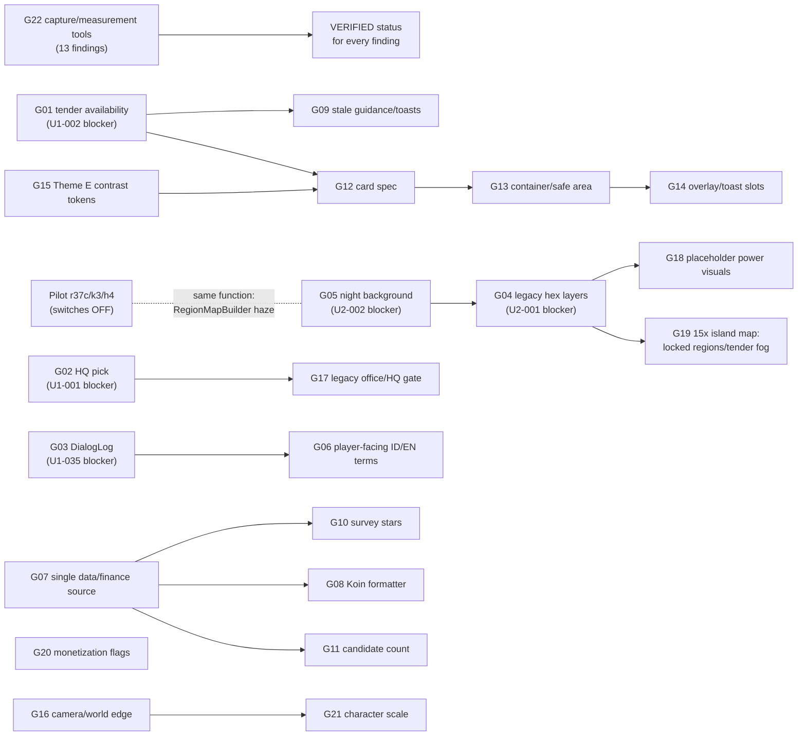

# REMEDIATION DEPENDENCY MAP — U37H (Batch 0)

Status: draft for user review. No code has changed. Batch 1 starts only after the user reviews the four discovery documents (directive addendum 1).

## 1. Dependency map between global root causes

How to read it: an arrow means "finish the left one first, or do them together". G22 gates every VERIFIED status: a finding may only be marked VERIFIED from a capture once the capture flow proves its state (correct scene, zoom, time, subject).

## 2. Fixes that must land together

| Bundle | RCs | Why together |
|---|---|---|
| Night environment | G05 + U1-016 (part of G05) | One night phase source for haze, background, ambient. Splitting it gives half-dark scenes. |
| Hex leftovers in the 15× world | G04 (+ the G06 hex string keys) | The overlay and the "hex" text appear in the same screens (19, 20, 29); fix and verify them in one capture. |
| Tender availability | G01 + the G09 tender mail/toast | The notification must be derived from the same state that fills the board. |
| Data/finance source | G07 + G08 + G10 | A single read layer. Changing the formatter without the source leaves contradictory numbers. |
| Card layout | G12 + G13 + G14 | The same card templates and slots. Separate patches would collide in the same USS/partials. |

## 3. Batch order (directive §20), mapped to RCs

| Batch | RC | Findings | Gate |
|---|---|---|---|
| 0 | discovery (this document) | 119 mapped | User review |
| 1 | G02, G01, G03, G04, G05 + first G22 diagnostics | 5 blockers + 10 related | Blockers fixed and verified on A57 + 960×540, regression 0 failures |
| 2 | G07, G08, G10, G09, G11 + rest of G01 | 27 | Finance consistency tests |
| 3 | G17, G18, G19, G16 (HQ/office/map/infrastructure) | 9 | HQ + office functional, map consistent |
| 4 | G20, G11 (employees/shop) | 5 | Monetization flags match decisions |
| 5 | G05 rest, G16, G21, pilot r37 (rendering/LOD) | ~6 + pilot | Day/night verified, FAR variants differ |
| 6 | G12, G13, G14, G15, G06 | 44 | A57 + 960×540 pass, no unintended English |
| 7 | performance on a physical Android device | — | Needs APK/HP (Firebase Test Lab or the user's phone) |
| 8 | G22 full + final QA | all | Release readiness |

G22 (tools) runs alongside from Batch 1, because blocker verification needs capture that is correct. G00 (10 unverified findings) gets a diagnostic capture in Batch 1 and is then assigned to its real RC.

## 4. Batch 1 plan: files, functions, dependencies, risks

All changes: one patch per blocker, own switch (OFF = U37H), manifest LENGKAP, gate `git apply --check` on top of the current stack (including r37k3/r37h4), offline compile 0, EditMode, then uidev A57 + 960×540 before/after. No feature flag defaults change for players except the blocker fixes themselves (each behind a switch that is ON in the 15× profile, after user review).

| Blocker | File (path under `RenewableCEO/Assets/Scripts/`) | Function | Change | Depends on | Regression risk | Test |
|---|---|---|---|---|---|---|
| U1-001 HQ pick panel empty | `Game/World/X15/Region15xPlay.cs` | `Zones()` (:47-53) | Mark the HQ cell (or the nearest pickable cell with lots) as `reco`; square outline for 15× cells | — | Hex-mode HQ pick (World15x off) must be unchanged | EditMode: `Zones()` returns exactly 1 reco that `HqPickable` accepts; uidev 05: `.pick-sheet` has content on both profiles |
| | `Game/UI/Screens/HubHUD.Onboarding.cs` | `ShowHqPick` (:476-478), `SelectTile` (:483) | Fallback to the first pickable tile; keep `_sheet` hidden until it has content; confirm label "Dirikan di sini" | — | Onboarding order (consent → director → company → HQ); save `profile.hq` unchanged | Same |
| U1-002 tender board empty | `Game/World/X15/Region15xPlay.cs` | `Attach` → `Company.X15EnsureFirstTender` (:70-77) | Post the tutorial-tender mail/toast only when the board is open (Lv 3 gate) and the tender is visible | G09 (stale messages) | Tutorial flow timing; CampaignTests; quest steps waiting on the mail | EditMode: no tender mail before the board gate; mail ⇒ tender in `BuildTenders` output |
| | `Game/UI/Screens/HubHUD.Missions.cs` | tutorial tender creation (:273-274) | Same gate; the mail is derived from board state | — | Same | Same |
| | `Game/UI/Screens/HubHUD.Projects.cs` | `BuildTenders` (:47-107, D1 card :93) | Available tenders first, D1 + locked cards after | Diagnostic: why the card exists but is not drawn (per-card worldBound/opacity log in uidev first) | Tender board layout at 960×540 (G12/G13) | uidev 19: tender card visible and first; layout test |
| U1-035 dialogue history | `Core/Progress/DialogControls.cs` | `DialogLog` (:17-38), `Clear()` (:38, 0 callers) | Store loc keys + args, translate on render; scope per save/session; call `Clear()` on new game / intro / load | G06 (missing ID keys) | Save files: history is not persisted today (UNVERIFIED, check); dialogue UI that reads `_lines` | EditMode: new game ⇒ empty log; language switch re-renders; chronological order; uidev intro_a3_id_log |
| U2-001 yellow bands | `Game/UI/Screens/HubHUD.Slots.cs` | `Map Grid Tender` outline (:161-180), enabled in normal Peta (:348) | Show only actionable tenders, only in tender/slot-picker context, 15× cell shape, thin rim drawn under PV, night-aware material | Diagnostic layer-toggle capture first (3 candidates per architecture agent) | Pre-15× mode keeps its outline; captures 19, 20, 29 | uidev 90–98 + winter_night: no persistent yellow band; selection still visible; meanL in range |
| | `Game/UI/Screens/HubHUD.SoftRegions.cs` | soft region tint (:27) | Same context rule | Same | Same | Same |
| | `Game/World/X15/Region15xPlay.cs` | lit-house cubes (:224-235) | Night-aware or hidden in normal view (G18 follow-up in Batch 3) | G18 | Night lights read as "houses powered" | Same |
| U2-002 bright night background | `Game/World/X15/RegionMapBuilder.cs` | haze plane (`Skirt`, :641-646) | Haze uses the same night shading/phase as the island edge | **r37c/r37k3 use the same haze/Apron**; one night phase (NightGrade vs NaturePilot duplicate) | Pilot daytime look (≤ ±3 meanL), r37k3 tests | winter_night meanL 80–112; daytime unchanged; r37k3 tests still pass |
| | `Game/World/NaturePilot.cs` | `Apply` (:72-75), `FromHour` (:40) | Read the night phase from one function (no new controller) | — | Map-screen colours | Same |

Before any of these: (1) a G22 diagnostic capture to confirm U1-002 drawing and U2-001 layer, without game changes; (2) a runtime check that switches OFF = U37H for r37k3/r37h4 (the architecture agent flagged that this is not yet proven).

## 5. Decisions needed from the user before Batch 1 / Batch 2

1. U1-032/U1-033: keep English institution names in the ID build (2 Nov decision), or switch to Indonesian/fictional names?
2. U1-031/U2-056: does the tester build keep "$" for Koin (8 Nov decision), or switch to "Koin" now?
3. U1-001: in 15× the HQ always lands on the plaza. Should "pick HQ" become a confirmation step ("Dirikan di sini") instead of a choice?
4. U2-049: Theme E green/mint contrast. Change the token? (A before/after sheet comes first.)

## 6. Tambahan Batch 0.5 (18 Nov 2026)

| Temuan | RC | Bergantung pada / memengaruhi | Batch | Catatan |
|---|---|---|---|---|
| U37H-B05-P1 kantor/plaza tak terjangkau di build pemain 15× (RegionCamera menjepit fokus tiap frame) | G17 | memengaruhi U2-004/U2-007/U2-008 (G17), G16 (kamera Beranda/foto), DX3 plaza, tangkapan winter office/plaza + perfshot kantor_dalam (tetap PRECONDITION_FAIL sampai diperbaiki) | 3 | perbaikan menyentuh perilaku kamera produk (clamp) → perubahan produk, perlu rencana + persetujuan; tidak di Batch 0.5/1 |
| U37H-B05-P2 "Naik level!" sebelum "Misi selesai" | G09 | urutan antrean pop-up (HubHUD.Popups / CheckMission); berkaitan U1-003/U1-004 (pesan dari satu state) | 2 | prioritas antre/urutan; tangkapan 16_mission1_done (F6d) menjadi bukti sebelum/sesudah |
